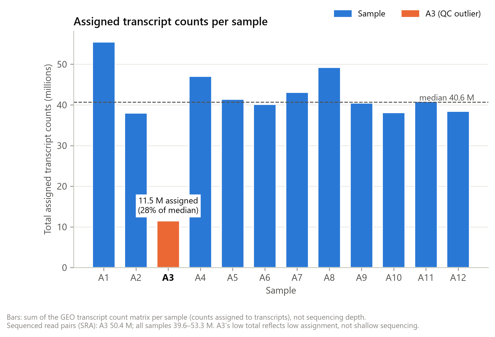
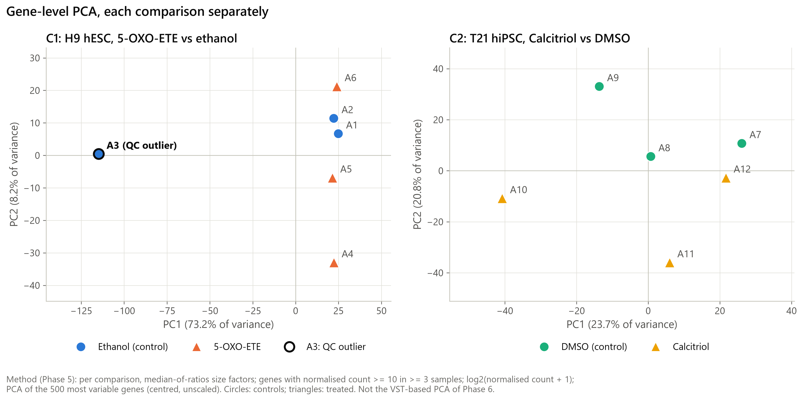
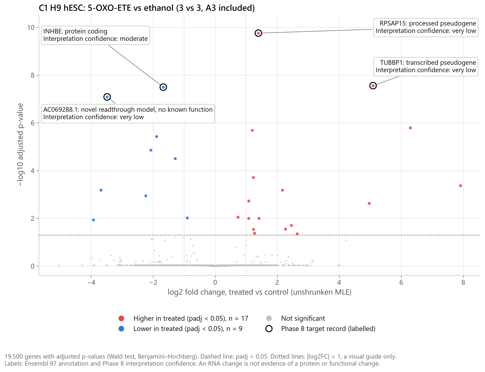
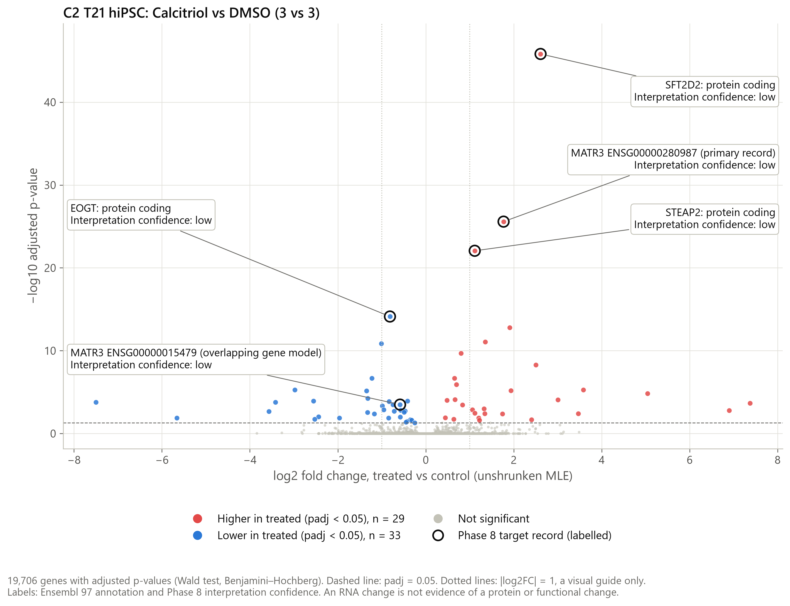
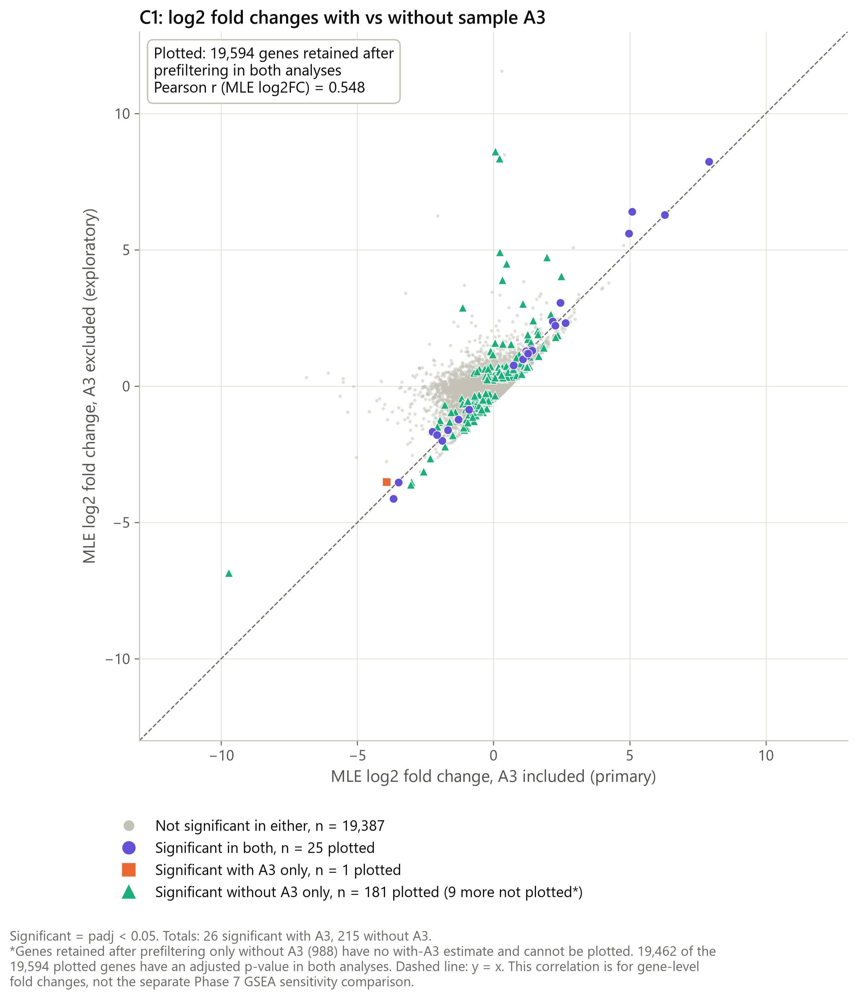
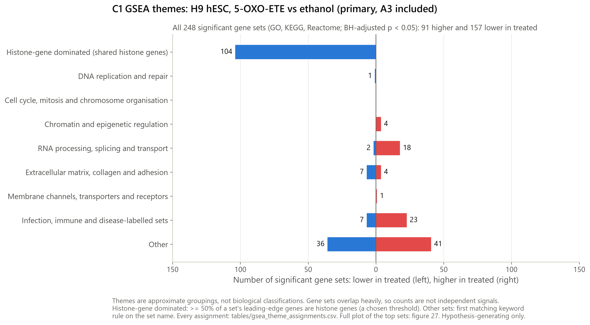
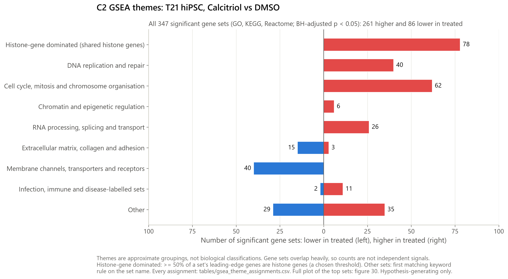

# RNA-seq Analysis of 5-OXO-ETE and Calcitriol Treatment Effects in Human Stem Cell Models

**Dataset:** [GSE213410 – NCBI Gene Expression Omnibus](https://www.ncbi.nlm.nih.gov/geo/query/acc.cgi?acc=GSE213410)

**Project type:** Public-dataset reanalysis  
**Field:** Bioinformatics | Computational Biology | Transcriptomics  
**Organism:** *Homo sapiens*

**Contents:** [Overview](#1-project-overview) · [Design](#3-dataset-and-experimental-design) · [Where the counts came from](#31-where-the-counts-came-from) · [Workflow](#5-analytical-workflow) · [Key findings](#6-key-findings) · [Phase 8 gene annotation](#65-phase-8-annotation-and-interpretation-of-selected-genes) · [Limitations](#7-challenges-and-limitations) · [Evidence map](#9-reproducibility-and-evidence-map) · [Regenerating figures](#91-regenerating-the-case-study-figures-and-validating-this-readme) · [Figures](#10-visual-results) · [Supplementary figures](#108-supplementary-figures)

## 1. Project Overview

This project investigates gene-expression patterns associated with 5-OXO-ETE and Calcitriol treatments in two human stem cell models using publicly available RNA-sequencing data.

The analysis was conducted using the GSE213410 dataset from the NCBI Gene Expression Omnibus (GEO). It started from the transcript-level read-count estimates supplied with the dataset, not from raw sequencing reads (see [Section 3.1](#31-where-the-counts-came-from)). It involved data exploration, quality control, experimental-design validation, transcript-to-gene aggregation, differential expression analysis, functional enrichment, and annotation and cautious interpretation of selected genes.

The objective was to develop practical skills in RNA-seq data analysis and understand how computational methods can be used to investigate gene-expression changes in biological experiments.

## 2. Research Questions

The project explored two independent comparisons:

- What gene-expression changes are associated with 5-OXO-ETE treatment in H9 human embryonic stem cells?
- What gene-expression changes are associated with Calcitriol treatment in trisomy 21 induced pluripotent stem cells?

These comparisons were analysed independently because they involved different cell models and experimental controls. Their results are never combined or compared with each other.

## 3. Dataset and Experimental Design

The project used the GSE213410 transcript read-count dataset, containing 12 samples.

| Comparison | Control | Treatment | Replicates |
|---|---|---|---|
| C1 – H9 hESCs | Ethanol | 5-OXO-ETE | 3 per group |
| C2 – Trisomy 21 hiPSCs | DMSO | Calcitriol | 3 per group |

The C1 control group included samples A1, A2 and A3. A3 was identified as a significant quality-control outlier and was retained in the primary analysis, with a separate exploratory sensitivity analysis excluding it.

### 3.1 Where the counts came from

This project did **not** run a raw-read-to-count pipeline. No reads were aligned, assembled or quantified here. The starting point was the transcript count matrix supplied on GEO.

| Step | Performed by | What it did |
|---|---|---|
| Alignment and transcript quantification | Data submitters | Reads were aligned with HISAT2, and transcript-level coverage was estimated with StringTie 1.3.3b. |
| Count estimation | Data submitters | Integer counts follow StringTie's `prepDE.py` formula: coverage × transcript length / read length, rounded up, for each transcript. They are **coverage-derived estimates**, not unique-read counts. |
| Transcript-to-gene aggregation | This project (Phase 5) | The 226,788 Ensembl transcripts (ENST) were summed into Ensembl release 97 genes. Every ENST mapped to exactly one gene, so this is a plain sum that allocates nothing between genes. The 27,832 novel StringTie transcripts (TCONS), holding 6.5% of counts, have no gene annotation and were excluded. |
| Differential expression | This project (Phase 6) | DESeq2 on the gene-level sums. |

Because the counts are estimates, any ambiguity between transcripts from overlapping gene models arises in StringTie's transcript-level estimation. That step was not examined in this project. Details: [PHASE6_REPORT.md, Section 1](../../results/PHASE6_REPORT.md) and [PHASE5_REPORT.md](../../results/PHASE5_REPORT.md).

## 4. Tools and Technologies

- **R:** Statistical analysis and data visualisation.
- **DESeq2:** Differential expression analysis.
- **clusterProfiler:** Functional enrichment analysis.
- **ReactomePA:** Reactome pathway enrichment.
- **fgsea:** Gene Set Enrichment Analysis (run through clusterProfiler).
- **Python:** Dataset exploration, quality-control workflows and Phase 8 annotation retrieval.
- **Pandas, Matplotlib and scikit-learn:** Data handling, visualisation and principal component analysis.
- **Git and GitHub:** Version control and project documentation.
- **NCBI GEO, Ensembl and UniProtKB:** Public data and reference annotation resources. Ensembl release 97 provided the gene models, and UniProtKB release 2026_04 provided protein function annotation in Phase 8.

## 5. Analytical Workflow

The project was completed in eight phases:

1. Project setup and documentation.
2. Dataset exploration and structural validation.
3. RNA-seq quality control and exploratory data analysis.
4. Sample metadata validation and experimental-design assessment.
5. Transcript-to-gene aggregation and gene-level quality control.
6. Differential expression analysis using DESeq2.
7. Functional enrichment analysis using GO, KEGG and Reactome, alongside GSEA.
8. Gene annotation, functional annotation and biological interpretation of eight selected genes (nine Ensembl gene records).

## 6. Key Findings

### 6.1 Quality Control

The dataset contained 254,620 transcript rows and 12 sample columns.

Sample A3 showed unusually low assigned transcript counts and substantially different expression patterns from the other samples. Further investigation showed that its sequencing depth was comparable to the other samples: approximately 50.4 million read pairs were sequenced for A3, but only approximately 11.5 million counts were assigned to transcripts. A3's low assigned count total therefore does not reflect low sequencing depth.

The underlying cause could not be established from the available GEO data, which include no alignment statistics. It remains unknown.

### 6.2 Differential Expression Analysis

Using an adjusted p-value threshold of 0.05:

| Comparison | Genes retained after prefiltering | Genes with valid p-values | Genes with adjusted p-values | Significant genes (adjusted p-value < 0.05) |
|---|---:|---:|---:|---:|
| C1 - 5-OXO-ETE vs Ethanol, A3 included | 19,594 | 19,500 | 19,500 | 26 |
| C1 - 5-OXO-ETE vs Ethanol, excluding A3 | 20,582 | 20,575 | 20,175 | 215 |
| C2 - Calcitriol vs DMSO | 19,736 | 19,706 | 19,706 | 62 |

How to read the columns:
- **Genes retained after prefiltering:** genes that passed the count filter and entered DESeq2. The filter required at least 10 raw counts in at least as many samples as the smallest group: 3 samples, or 2 in the analysis without A3. The smaller threshold is one reason that analysis retained more genes.
- **Genes with valid p-values:** DESeq2 sets the p-value to missing for genes flagged as count outliers by Cook's distance. There were 94, 7 and 30 such genes in the three analyses.
- **Genes with adjusted p-values:** DESeq2's independent filtering also removed 400 low-mean genes from multiple-testing adjustment in the analysis without A3.

Source: [phase6_de_summary.csv](../../results/tables/phase6_de_summary.csv).

The C1 analysis excluding A3 was treated as exploratory because it retained only two control replicates and the exclusion was informed by the observed QC results.

### 6.3 A3 Sensitivity Analysis (C1)

The two C1 analyses were compared gene by gene. Source: [C1_A3_sensitivity_summary.csv](../../results/tables/C1_A3_sensitivity_summary.csv).

- **Denominator of the comparison:** 19,594 genes were retained after prefiltering in **both** analyses. The Phase 6 summary table labels these "genes tested in both". All 19,594 have an MLE log2 fold change in both analyses, and 19,462 have an adjusted p-value in both. The 988 genes retained only in the analysis without A3 have no estimate with A3.
- **Significant genes:**
  - 26 with A3 included;
  - 215 with A3 excluded;
  - 25 in both;
  - 1 with A3 included only;
  - 190 with A3 excluded only, of which 181 are among the 19,594 shared genes and 9 were retained only without A3.
- **Agreement of fold changes:** the Pearson correlation of unshrunken (MLE) log2 fold changes across the 19,594 shared genes was **0.548**. This gene-level correlation is separate from the Phase 7 GSEA sensitivity comparison, which correlated gene-set enrichment scores (Pearson r = 0.515 across 9,434 shared gene sets; [PHASE7_REPORT.md](../../results/PHASE7_REPORT.md)).
- **Agreement of direction:** all 25 genes significant in both analyses changed in the same direction.

Removing A3 changes the C1 results substantially. The primary analysis keeps A3, and the analysis without it is exploratory.

### 6.4 Functional Enrichment

Functional enrichment was performed independently for the three differential-expression analyses.

The GSEA analysis identified significant gene sets across Gene Ontology, KEGG and Reactome databases.

The results suggested associations with biological themes including chromatin organisation, nucleosome-related processes, RNA regulation, cell-cycle activity and DNA repair. Many significant gene sets share the same genes, particularly histone genes, so the number of significant sets overstates the number of distinct signals. Sections 10.6 and 10.7 summarise all significant sets by theme.

These findings are hypothesis-generating. They do not establish that the treatments activate or inhibit these pathways.

### 6.5 Phase 8: Annotation and Interpretation of Selected Genes

Phase 8 annotated eight genes from the significant differential-expression results: four from C1 and four from C2. The project author chose these genes judgementally, as illustrative examples for biological interpretation. No formal selection criteria were recorded, so they should not be read as the "top" or most important genes. MATR3 has two Ensembl gene IDs, which are kept as separate records, giving nine records. Phase 8 had three parts:

- **Gene annotation:** official Ensembl release 97 records, the same release as the gene models used in Phases 5–7. The archive website for that release has been retired, so the records were extracted from the release 97 database files, which were checked against Ensembl's published checksums. See the [provenance report](../../results/PHASE8_ANNOTATION_PROVENANCE.md).
- **Functional annotation:** UniProtKB release 2026_04 (human only, reviewed records preferred). A protein record was used only when an explicit cross-reference existed and its sequence was identical to an Ensembl 97 protein of that gene. See the [provenance report](../../results/PHASE8_FUNCTIONAL_ANNOTATION_PROVENANCE.md).
- **Biological interpretation:** what is known, what the data show, what they may suggest, and what cannot be concluded, each kept separate. Every record has three rule-based confidence ratings. See the [interpretation report](../../results/PHASE8_BIOLOGICAL_INTERPRETATION.md).

| Comparison | Gene (Ensembl ID) | Annotation | log2FC | Adjusted p | Expression signal | Effect-size precision | Interpretation confidence |
|---|---|---|---:|---:|---|---|---|
| C1 | RPSAP15 (ENSG00000237506) | Processed pseudogene | 1.39 | 1.73e-10 | High | Good | Very low |
| C1 | TUBBP1 (ENSG00000127589) | Transcribed processed pseudogene | 5.09 | 2.75e-08 | High | Low | Very low |
| C1 | INHBE (ENSG00000139269) | Protein coding; reviewed UniProt record P58166 | −1.67 | 3.17e-08 | High | Good | Moderate |
| C1 | AC069288.1 (ENSG00000286192) | Novel readthrough gene model; no known function | −3.48 | 8.17e-08 | Moderate | Low | Very low |
| C2 | SFT2D2 (ENSG00000213064) | Protein coding; function by similarity only | 2.61 | 1.52e-46 | High | Good | Low |
| C2 | MATR3, primary record (ENSG00000280987) | Overlapping MATR3 gene model; unreviewed, automatic annotation only | 1.77 | 2.64e-26 | Moderate | Good | Low |
| C2 | MATR3, overlapping model (ENSG00000015479) | Overlapping MATR3 gene model; reviewed UniProt record P43243 | −0.59 | 3.26e-04 | Low | Good | Low |
| C2 | STEAP2 (ENSG00000157214) | Protein coding; enzyme function by similarity | 1.11 | 8.73e-23 | High | Good | Low |
| C2 | EOGT (ENSG00000163378) | Protein coding; experimentally supported function | −0.81 | 7.51e-15 | Moderate | Good | Low |

log2FC is the unshrunken DESeq2 estimate, treated vs control, within each comparison. All nine records are significant in their own comparison. Full values, intervals and evidence classes are in [phase8_gene_interpretation.csv](../../results/tables/phase8_gene_interpretation.csv).

**Interpretation cautions:**

- **Pseudogenes (RPSAP15, TUBBP1).** A change in signal assigned to a pseudogene is not evidence that a protein is made. Some reads may come from the related parent genes. TUBBP1's increase is well supported in direction, but its size is imprecise (approximate 95% interval 13- to 92-fold) because the control baseline is very low.
- **Readthrough and novel models (AC069288.1).** This model has no known function. Its only UniProt cross-reference is an unreviewed record that was not used. It overlaps MAD1L1 and MRM2, so its estimate may not be independent of theirs.
- **Unreviewed or similarity-based annotation.** The function annotation for SFT2D2, STEAP2 and the primary MATR3 record rests on similarity or automatic annotation, not on experiments on the protein.
- **RNA is not protein.** No record shows a change in protein, activity or function. No record is rated High for interpretation confidence.
- **A3.** All four C1 records stay significant in the same direction without A3. That analysis is exploratory.

### 6.6 The Two MATR3 Gene Models

Ensembl release 97 contains two overlapping gene records named MATR3 on chromosome 5. They share 14 identical exons. They were analysed as separate genes and gave opposite results in C2:

| Record | log2FC | Adjusted p | Direction with Calcitriol |
|---|---:|---:|---|
| ENSG00000280987 (primary record; 10 of 11 transcripts flagged as readthrough) | 1.77 | 2.64e-26 | Higher |
| ENSG00000015479 (overlapping model; reviewed UniProt record P43243) | −0.59 | 3.26e-04 | Lower |

Each record's count is a separate sum of StringTie estimates for its own transcripts. Because the models share sequence, the same reads can be compatible with transcripts of both, and the two estimates **may not be independent**. The opposite directions could reflect:
- a real change in the relative abundance of transcript structures at the locus;
- ambiguity in estimating overlapping transcripts;
- or both.

These data cannot distinguish between them. The two results should not be read as two independent biological changes. Neither result shows a change in MATR3 protein. The reviewed MATR3 annotation was not transferred to ENSG00000280987, because Ensembl 97 contains no cross-reference linking them. Resolving this would need a transcript-level analysis of the locus, which was not part of this project.

## 7. Challenges and Limitations

Important limitations encountered during this project included:

- A3 was a substantial technical outlier, but its underlying cause could not be confirmed.
- Each experimental group had only three biological replicates.
- Excluding A3 reduced the C1 control group to two replicates.
- The 27,832 novel StringTie transcripts (TCONS), holding 6.5% of counts, have no Ensembl annotation and were excluded from the gene-level matrix. All Ensembl (ENST) transcripts were mapped.
- Counts are StringTie coverage-derived estimates supplied by the submitters, not unique-read counts produced in this project. How StringTie handled reads shared by overlapping gene models was not examined.
- Functional enrichment results depended on the available annotation databases and their versions.
- Some enriched pathways shared many of the same genes, creating redundancy.
- The experiments involved individual cell models and a single 24-hour treatment time point.
- Phase 8 annotation is time-stamped: gene models come from Ensembl 97 (2019) and protein annotation from UniProtKB 2026_04. Several documented functions rest on similarity or automatic annotation.
- The analysis identifies statistical associations, not biological causation. RNA changes do not demonstrate protein or functional changes.

These limitations were documented to ensure that the results are interpreted appropriately.

## 8. Skills Demonstrated

Through this project, I developed practical experience in:

- Working with public RNA-seq datasets.
- Exploring and validating high-dimensional biological data.
- Performing sample-level quality control.
- Investigating outlier samples.
- Understanding and validating experimental designs.
- Mapping transcript identifiers to gene identifiers.
- Performing differential expression analysis with DESeq2.
- Conducting GO, KEGG and Reactome enrichment analyses.
- Performing GSEA.
- Retrieving versioned gene and protein annotation with documented provenance.
- Interpreting biological results cautiously.
- Documenting reproducible computational workflows.
- Managing code and research outputs using Git and GitHub.

## 9. Reproducibility and Evidence Map

The analysis scripts, output tables, figures and technical reports are maintained in this GitHub repository. The original dataset is available through [NCBI GEO – GSE213410](https://www.ncbi.nlm.nih.gov/geo/query/acc.cgi?acc=GSE213410).

| Phase | Script | Report | Key tables | Validation |
|---|---|---|---|---|
| 1–2. Setup and exploration | [01_dataset_inspection.py](../../data/raw/notebooks/01_dataset_inspection.py), [02_dataset_exploration.py](../../data/raw/notebooks/02_dataset_exploration.py) | – | – | – |
| 3. Quality control | [03_rnaseq_quality_control.py](../../data/raw/notebooks/03_rnaseq_quality_control.py) | – | [sample_qc_metrics.csv](../../results/tables/sample_qc_metrics.csv), [count_provenance_check.csv](../../results/tables/count_provenance_check.csv) | – |
| 4. Metadata and design | [04_sample_metadata.py](../../data/raw/notebooks/04_sample_metadata.py) | – | [sample_metadata.csv](../../data/metadata/sample_metadata.csv), [experimental_design_summary.csv](../../results/tables/experimental_design_summary.csv) | [metadata_validation_report.csv](../../results/tables/metadata_validation_report.csv) |
| 5. Gene aggregation | [05_transcript_to_gene_aggregation.py](../../data/raw/notebooks/05_transcript_to_gene_aggregation.py) | [PHASE5_REPORT.md](../../results/PHASE5_REPORT.md) | [transcript_mapping_summary.csv](../../results/tables/transcript_mapping_summary.csv), [gene_level_A3_sensitivity.csv](../../results/tables/gene_level_A3_sensitivity.csv) | [phase5_validation_report.csv](../../results/tables/phase5_validation_report.csv) |
| 6. Differential expression | [06_differential_expression_analysis.R](../../data/raw/notebooks/06_differential_expression_analysis.R) | [PHASE6_REPORT.md](../../results/PHASE6_REPORT.md) | [phase6_de_summary.csv](../../results/tables/phase6_de_summary.csv), [C1_differential_expression.csv](../../results/tables/C1_differential_expression.csv), [C2_differential_expression.csv](../../results/tables/C2_differential_expression.csv), [C1_A3_sensitivity_summary.csv](../../results/tables/C1_A3_sensitivity_summary.csv) | [phase6_validation_report.csv](../../results/tables/phase6_validation_report.csv) |
| 7. Enrichment | [07_functional_enrichment.R](../../data/raw/notebooks/07_functional_enrichment.R) | [PHASE7_REPORT.md](../../results/PHASE7_REPORT.md) | [phase7_enrichment_summary.csv](../../results/tables/phase7_enrichment_summary.csv), [phase7_database_versions.csv](../../results/tables/phase7_database_versions.csv) | [phase7_validation_report.csv](../../results/tables/phase7_validation_report.csv) |
| 8. Gene annotation | [08_gene_annotation_retrieval.py](../../data/raw/notebooks/08_gene_annotation_retrieval.py) | [PHASE8_ANNOTATION_PROVENANCE.md](../../results/PHASE8_ANNOTATION_PROVENANCE.md) | [phase8_target_gene_annotation.csv](../../results/tables/phase8_target_gene_annotation.csv) | [08_validate_gene_annotation.py](../../data/raw/notebooks/08_validate_gene_annotation.py) → [phase8_annotation_validation.csv](../../results/tables/phase8_annotation_validation.csv) |
| 8. Functional annotation | [08b_uniprot_functional_annotation.py](../../data/raw/notebooks/08b_uniprot_functional_annotation.py) | [PHASE8_FUNCTIONAL_ANNOTATION_PROVENANCE.md](../../results/PHASE8_FUNCTIONAL_ANNOTATION_PROVENANCE.md) | [phase8_functional_annotation.csv](../../results/tables/phase8_functional_annotation.csv), [phase8_uniprot_mapping.csv](../../results/tables/phase8_uniprot_mapping.csv) | [phase8_functional_validation.csv](../../results/tables/phase8_functional_validation.csv) |
| 8. Interpretation | [08c_biological_interpretation.py](../../data/raw/notebooks/08c_biological_interpretation.py) | [PHASE8_BIOLOGICAL_INTERPRETATION.md](../../results/PHASE8_BIOLOGICAL_INTERPRETATION.md) | [phase8_gene_interpretation.csv](../../results/tables/phase8_gene_interpretation.csv) | [phase8_gene_interpretation_validation.csv](../../results/tables/phase8_gene_interpretation_validation.csv) |
| Case-study figures | [make_figure_01_assigned_counts.py](scripts/make_figure_01_assigned_counts.py), [make_case_study_figures.py](scripts/make_case_study_figures.py) | This README | [gsea_theme_summary.csv](tables/gsea_theme_summary.csv), [gsea_theme_assignments.csv](tables/gsea_theme_assignments.csv), [gsea_histone_threshold_sensitivity.csv](tables/gsea_histone_threshold_sensitivity.csv) | [validate_case_study_readme.py](scripts/validate_case_study_readme.py) |

The full set of phase figures is in [results/figures/](../../results/figures/). The case-study figures are in [figures/](figures/). Figures with a "b" suffix are improved presentation versions. The originals are kept unchanged.

Most numerical claims in this README are checked against machine-readable outputs by [`scripts/validate_case_study_readme.py`](scripts/validate_case_study_readme.py). Other figures and methodological details have been manually verified against their respective source files and analysis records. The script also checks that every relative link and image in this README points to a file in the repository.

### 9.1 Regenerating the case-study figures and validating this README

These steps regenerate only the presentation outputs in this folder. They do not re-run the Phase 1–8 analysis, and they read the saved Phase 5–8 result tables without changing them.

**Environment used.** The outputs in this repository were produced with:
- Python 3.15.2, with pandas 3.1.1, numpy 2.5.5, matplotlib 3.11.2 and scikit-learn 1.9.1;
- Git 2.56.1;
- Windows, with the Segoe UI font.

No lock file pins these versions, and other versions have not been tested. On systems without Segoe UI, matplotlib falls back to Arial or DejaVu Sans, which can shift label positions slightly without changing any plotted value.

**Working directory.** Any directory. Each script finds the repository root from its own location. The commands below assume you are at the repository root.

**Order and commands:**

1. *(Optional)* Redraw figure 01:

   ```
   python projects/rnaseq-gse213410-case-study/scripts/make_figure_01_assigned_counts.py
   ```

   It reads `data/raw/GSE213410_transcripts.readcount.txt.gz` and **overwrites** `figures/01_library_sizes.png` with the same values. It stops if its totals differ from `results/tables/count_provenance_check.csv`.

2. Regenerate the "b" figures and the theme tables. Write them to a separate folder first, to check them without touching the repository:

   ```
   python projects/rnaseq-gse213410-case-study/scripts/make_case_study_figures.py <output-folder>
   ```

   Without an argument, the script writes into `figures/` and `tables/` here, and **refuses to run if any of its outputs already exist**. To regenerate in place, delete only these files first:
   - `figures/11b_*`, `13b_*`, `14b_*`, `25b_*`, `27b_*` and `30b_*`;
   - `tables/gsea_theme_assignments.csv`, `gsea_theme_summary.csv` and `gsea_histone_threshold_sensitivity.csv`.

   Never delete the original figures (names without "b"); the script cannot recreate them. The script stops if any built-in data check fails.

3. Validate the README:

   ```
   python projects/rnaseq-gse213410-case-study/scripts/validate_case_study_readme.py
   ```

   This writes nothing and exits with code 0 only if every check passes. It needs `git`, because it compares the original figures with the committed versions.

## 10. Visual Results

### 10.1 Assigned transcript counts per sample



Each bar is a sample's total assigned transcript count: the sum of its column in the GEO transcript count matrix. This is not sequencing depth. A3 had approximately 11.5 million assigned counts, 28% of the 40.6 million median; the other 11 samples range from roughly 38 to 55 million. A3 was sequenced to a similar depth to the other samples (approximately 50.4 million read pairs; range across all samples 39.6–53.3 million), so its low total reflects a low proportion of reads assigned to transcripts, not low sequencing depth. **The cause of that low assignment remains unknown.** GEO provides no alignment statistics, so it could not be investigated. This version of the figure was relabelled for the case study by [`scripts/make_figure_01_assigned_counts.py`](scripts/make_figure_01_assigned_counts.py); the plotted values are identical to the Phase 3 figure.

### 10.2 Gene-level PCA



These are principal component plots for each comparison. Each uses the 500 most variable genes after median-of-ratios normalisation and a log2(normalised count + 1) transform, the Phase 5 QC method. This is not the variance-stabilising transformation (VST) used for the Phase 6 PCA plots. Controls are drawn as circles and treated samples as triangles, so groups can be told apart without relying on colour.

In C1, sample A3 is far from the other five samples along PC1, which explains 73.2% of the variance. In C2, the DMSO and Calcitriol samples do not form clearly separate groups on the first two components, which explain 23.7% and 20.8% of the variance. Weak separation in a PCA plot does not by itself rule out treatment-associated differences in individual genes. The original figure is [Supplementary S1](#108-supplementary-figures).

### 10.3 Differential expression: 5-OXO-ETE vs ethanol control (C1)



The primary C1 analysis, with A3 included, found 26 genes with adjusted p < 0.05: 17 higher and 9 lower in the treatment group. The plot shows unshrunken (MLE) log2 fold changes. The vertical lines at |log2 fold change| = 1 are a visual guide only and were not a filtering threshold.

Only the four Phase 8 targets are labelled, each with its annotation and interpretation confidence:
- **Pseudogenes:** two of the four (RPSAP15, TUBBP1) are pseudogenes, so their signal cannot be read as protein production.
- **AC069288.1:** a novel readthrough gene model with no known function.
- **INHBE:** the only C1 target with experimentally supported function. In C2, EOGT and the overlapping MATR3 record (ENSG00000015479) also have experimental support.

With three replicates per group and A3 in the control group, these results should be read with the quality-control caveats in Section 6.1. The original figure, with the 12 most significant genes labelled, is [Supplementary S2](#108-supplementary-figures).

### 10.4 Differential expression: Calcitriol vs DMSO control (C2)



The C2 analysis found 62 genes with adjusted p < 0.05: 29 higher and 33 lower in the Calcitriol group. As in C1, the x-axis shows unshrunken log2 fold changes and the vertical lines are a visual guide only.

To reduce crowding, only the Phase 8 target records are labelled. The two overlapping MATR3 gene models keep their Ensembl IDs because they moved in opposite directions; see [Section 6.6](#66-the-two-matr3-gene-models) for why they should not be read as independent changes. The comparison rests on three replicates per group at a single time point. The original figure is [Supplementary S3](#108-supplementary-figures).

### 10.5 Sensitivity analysis: C1 with and without sample A3



Each point is one of the **19,594 genes retained after prefiltering in both C1 analyses** (labelled "genes tested in both" in the Phase 6 output). The plot compares each gene's MLE log2 fold change with A3 included and with A3 excluded. Across these genes the Pearson correlation was 0.548.

Of the significant genes, 25 were significant in both analyses, 1 only with A3 included and 190 only with A3 excluded. Of those 190, 181 are plotted. The other 9 passed prefiltering only in the analysis without A3, so they have no estimate with A3.

Removing A3 therefore changes the C1 results substantially. The A3-excluded analysis remains exploratory, because it has only two control replicates and the exclusion decision was informed by the QC results. The original figure's legend counted all 190 genes although only 181 are drawn. This version states the denominator explicitly. The original is [Supplementary S4](#108-supplementary-figures).

### 10.6 GSEA themes: C1 comparison



This chart summarises **all** 248 significant gene sets (BH-adjusted p < 0.05) from the primary C1 GSEA: 91 higher and 157 lower in the treatment group. Genes were ranked by the DESeq2 Wald statistic.

How the themes were assigned:
- A set counts as **histone-gene dominated** when at least 50% of its leading-edge genes are histone genes.
- Other sets were grouped by fixed keyword rules on the set name. Sets that matched no rule are counted as "Other".
- Sets named for a viral protein or a host–pathogen process are grouped with the infection-labelled sets. In C1 this applies to "Nuclear import of Rev protein" and "Interactions of Rev with host cellular proteins", where Rev is an HIV-1 protein, and "Transport of Ribonucleoproteins into the Host Nucleus", an influenza pathway. Their leading-edge genes are host nuclear-pore proteins, shared with their explicitly viral sibling pathways such as "Rev-mediated nuclear export of HIV RNA". The grouping therefore follows each pathway's viral context, not the identity of its leading-edge genes. Like every theme here, it is an approximate, keyword-based grouping.
- Sets whose names or leading-edge genes do not point clearly to one theme were left in "Other" rather than forced into one. These include helicase activity, which mixes RNA and DNA helicases, and septin and tubulin-folding sets.
- Every assignment is listed in [gsea_theme_assignments.csv](tables/gsea_theme_assignments.csv).

**These themes are approximate groupings for presentation, not definitive biological classifications.** The 50% histone threshold is a chosen cut-off. [gsea_histone_threshold_sensitivity.csv](tables/gsea_histone_threshold_sensitivity.csv) shows how many sets it captures: 108, 104 and 101 C1 sets at 40%, 50% and 60%, and 89, 78 and 69 C2 sets. Sets just below the cut-off can still contain many histone genes; for example, C2 "nucleosome organization" has 49% and is counted under chromatin and epigenetic regulation.

104 of the 157 "lower in treatment" sets are histone-gene dominated. These include nucleosome, chromatin, infection and disease sets that share the same histone genes, so they reflect one overlapping signal rather than many independent findings. Among the named themes, the most frequent "higher in treatment" themes were infection, immune and disease-labelled sets (23) and RNA processing, splicing and transport (18 sets). A further 41 "higher in treatment" sets matched no theme rule. The infection and disease labels come from the pathway databases and do not indicate infection in these cells.

These results are hypothesis-generating and do not show that 5-OXO-ETE activates or inhibits any pathway. The full plot of the top sets per database is [Supplementary S5](#108-supplementary-figures).

### 10.7 GSEA themes: C2 comparison



The same summary for C2, with the same theme rules: 347 significant gene sets, 261 higher and 86 lower in the Calcitriol group.

- **Higher in treatment:** histone-gene dominated sets (78), cell cycle, mitosis and chromosome organisation (62), and DNA replication and repair (40).
- **Lower in treatment:** membrane channels, transporters and receptors (40), and extracellular matrix, collagen and adhesion (15).

Many of these sets overlap through shared genes, so the counts overstate the number of distinct signals. These associations are hypothesis-generating and do not establish a causal effect of Calcitriol. Cell-cycle and DNA-repair enrichment, for example, does not by itself show a change in proliferation. The full plot is [Supplementary S6](#108-supplementary-figures).

### 10.8 Supplementary figures

The original versions are kept unchanged, for reference and for full detail.

| | Figure | Notes |
|---|---|---|
| S1 | [Gene-level PCA (original)](figures/11_gene_level_pca.png) | Same data as Section 10.2; groups distinguished by colour only. |
| S2 | [C1 volcano (original)](figures/13_C1_volcano.png) | Labels the 12 most significant genes. |
| S3 | [C2 volcano (original)](figures/14_C2_volcano.png) | Labels the 12 most significant genes; MATR3 ENSG00000280987 identified by ID. |
| S4 | [C1 A3 sensitivity (original)](figures/25_C1_A3_sensitivity_LFC_comparison.png) | Legend count of 190 "without A3 only" genes includes 9 that are not plotted (see Section 10.5). |
| S5 | [C1 GSEA, full lollipop plot](figures/27_C1_GSEA.png) | Up to six significant sets per database and direction, with normalised enrichment scores. |
| S6 | [C2 GSEA, full lollipop plot](figures/30_C2_GSEA.png) | As S5, for C2. |

## 11. Conclusion

This project provided practical experience in the analysis of RNA-sequencing data, from the supplied transcript count estimates through quality control, differential expression and functional enrichment to the annotation and cautious interpretation of selected genes.

It also demonstrated the importance of sample quality control, appropriate experimental comparisons, annotation consistency and provenance, reproducibility and cautious interpretation of computational results.

The work represents an independent educational reanalysis of publicly available data and forms part of my developing portfolio in bioinformatics and computational biology.

---

**Project status:** Eight analytical phases completed, including Phase 8 gene annotation, functional annotation and biological interpretation.<br>
**Next step:** Continue developing practical bioinformatics projects and research skills.
