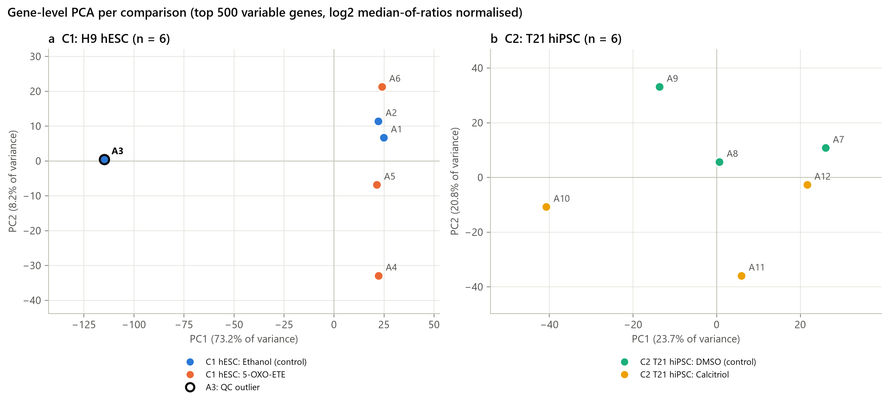
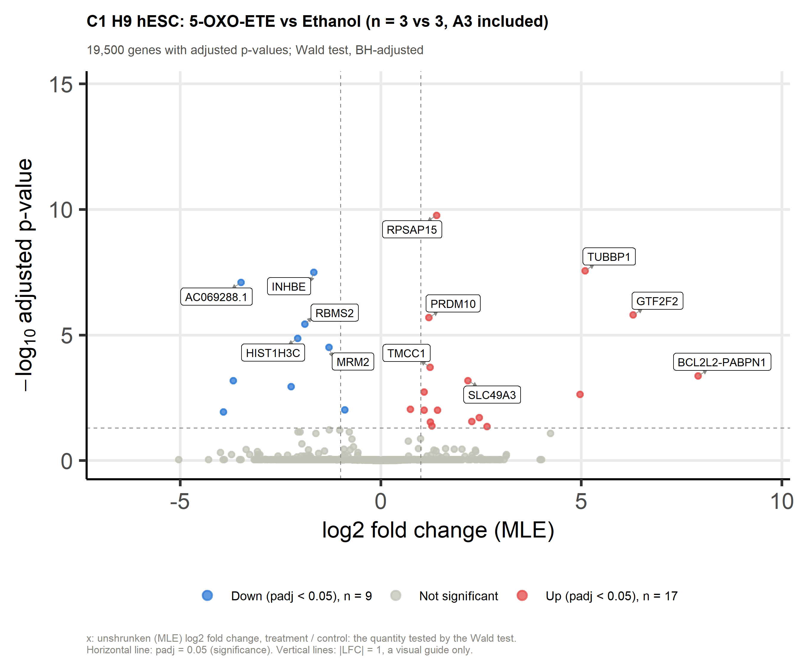
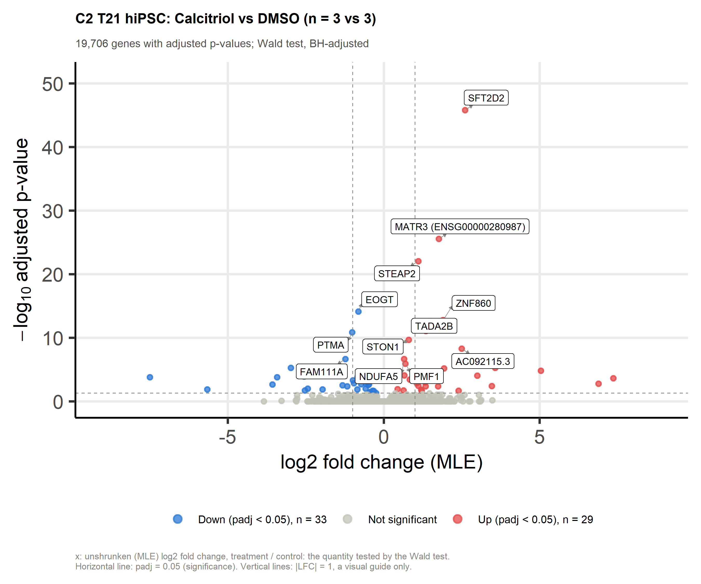
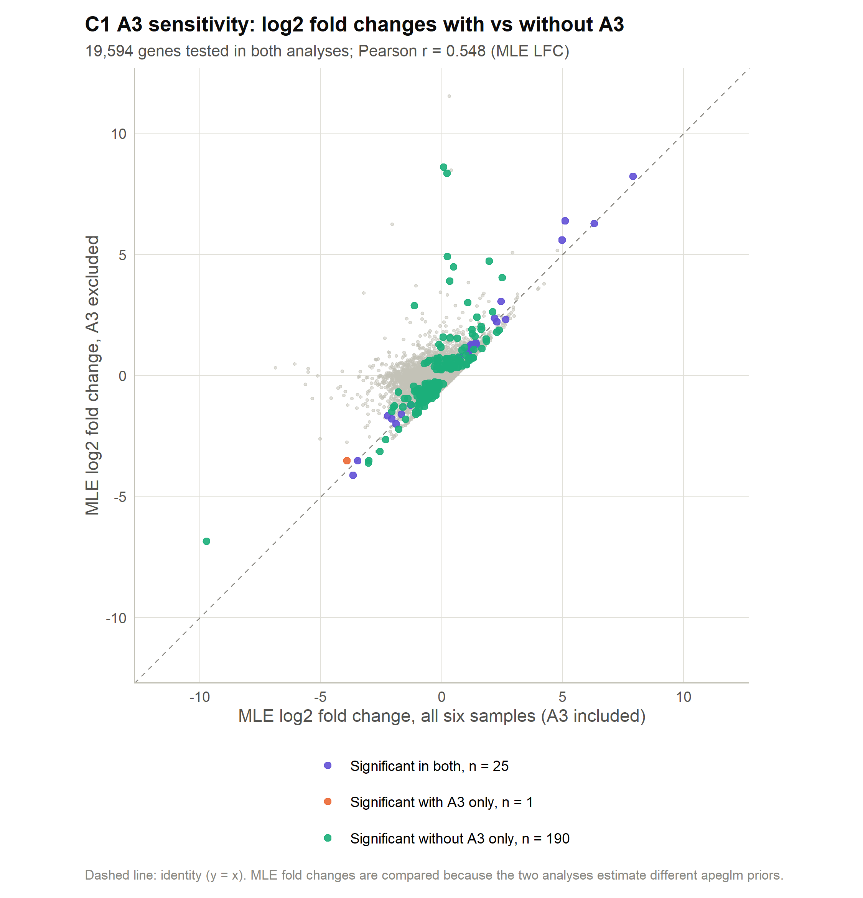
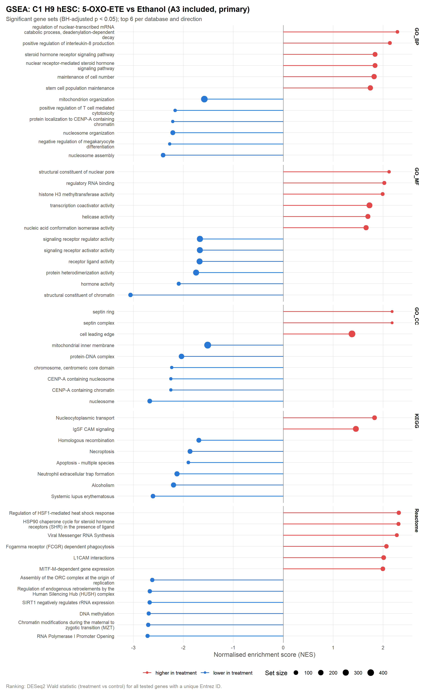
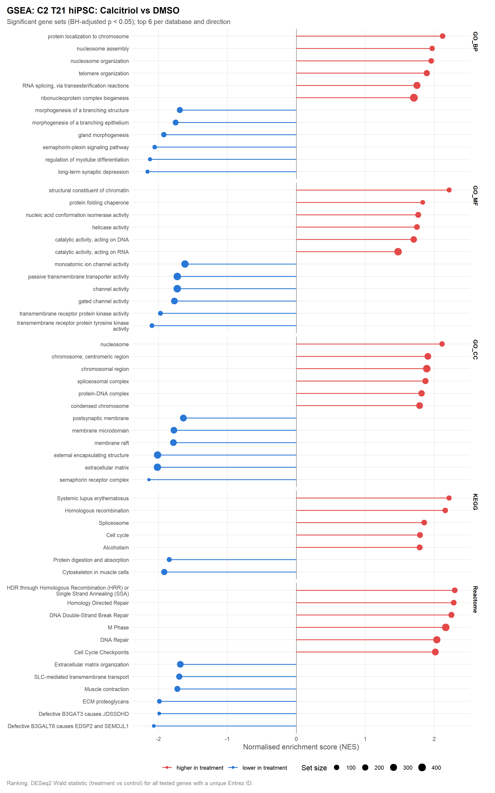

# RNA-seq Analysis of 5-OXO-ETE and Calcitriol Treatment Effects in Human Stem Cell Models

**Dataset:** [GSE213410 – NCBI Gene Expression Omnibus](https://www.ncbi.nlm.nih.gov/geo/query/acc.cgi?acc=GSE213410)

**Project type:** Public-dataset reanalysis  
**Field:** Bioinformatics | Computational Biology | Transcriptomics  
**Organism:** *Homo sapiens*

## 1. Project Overview

This project investigates gene-expression patterns associated with 5-OXO-ETE and Calcitriol treatments in two human stem cell models using publicly available RNA-sequencing data.

The analysis was conducted using the GSE213410 dataset from the NCBI Gene Expression Omnibus (GEO). It involved data exploration, quality control, experimental-design validation, transcript-to-gene aggregation, differential expression analysis and functional enrichment.

The objective was to develop practical skills in RNA-seq data analysis and understand how computational methods can be used to investigate gene-expression changes in biological experiments.

## 2. Research Questions

The project explored two independent comparisons:

- What gene-expression changes are associated with 5-OXO-ETE treatment in H9 human embryonic stem cells?
- What gene-expression changes are associated with Calcitriol treatment in trisomy 21 induced pluripotent stem cells?

These comparisons were analysed independently because they involved different cell models and experimental controls.

## 3. Dataset and Experimental Design

The project used the GSE213410 transcript read-count dataset, containing 12 samples.

| Comparison | Control | Treatment | Replicates |
|---|---|---|---|
| C1 – H9 hESCs | Ethanol | 5-OXO-ETE | 3 per group |
| C2 – Trisomy 21 hiPSCs | DMSO | Calcitriol | 3 per group |

The C1 control group included samples A1, A2 and A3. A3 was identified as a significant quality-control outlier and was retained in the primary analysis, with a separate exploratory sensitivity analysis excluding it.

## 4. Tools and Technologies

- **R:** Statistical analysis and data visualisation.
- **DESeq2:** Differential expression analysis.
- **clusterProfiler:** Functional enrichment analysis.
- **ReactomePA:** Reactome pathway enrichment.
- **fgsea:** Gene Set Enrichment Analysis.
- **Python:** Dataset exploration and quality-control workflows.
- **Pandas, Matplotlib and scikit-learn:** Data handling, visualisation and principal component analysis.
- **Git and GitHub:** Version control and project documentation.
- **NCBI GEO and Ensembl:** Public data and reference annotation resources.

## 5. Analytical Workflow

The project was completed in seven phases:

1. Project setup and documentation.
2. Dataset exploration and structural validation.
3. RNA-seq quality control and exploratory data analysis.
4. Sample metadata validation and experimental-design assessment.
5. Transcript-to-gene aggregation and gene-level quality control.
6. Differential expression analysis using DESeq2.
7. Functional enrichment analysis using GO, KEGG and Reactome, alongside GSEA.

## 6. Key Findings

### 6.1 Quality Control

The dataset contained 254,620 transcript rows and 12 sample columns.

Sample A3 showed unusually low assigned transcript counts and substantially different expression patterns from the other samples. Further investigation showed that its sequencing depth was comparable to the other samples: approximately 50.4 million read pairs were sequenced for A3, but only approximately 11.5 million counts were assigned to transcripts. A3's low assigned count total therefore does not reflect low sequencing depth.

The underlying cause could not be established from the available GEO data.

### 6.2 Differential Expression Analysis

Using an adjusted p-value threshold of 0.05:

| Comparison | Genes tested | Significant genes |
|---|---:|---:|
| C1 – 5-OXO-ETE vs Ethanol, A3 included | 19,594 | 26 |
| C1 – 5-OXO-ETE vs Ethanol, excluding A3 | 20,582 | 215 |
| C2 – Calcitriol vs DMSO | 19,736 | 62 |

The C1 analysis excluding A3 was treated as exploratory because it retained only two control replicates and the exclusion was informed by the observed QC results.

### 6.3 Functional Enrichment

Functional enrichment was performed independently for the three differential-expression analyses.

The GSEA analysis identified significant gene sets across Gene Ontology, KEGG and Reactome databases.

The results suggested associations with biological themes including chromatin organisation, nucleosome-related processes, RNA regulation, cell-cycle activity and DNA repair.

These findings are hypothesis-generating. They do not establish that the treatments activate or inhibit these pathways.

## 7. Challenges and Limitations

Important limitations encountered during this project included:

- A3 was a substantial technical outlier, but its underlying cause could not be confirmed.
- Each experimental group had only three biological replicates.
- Excluding A3 reduced the C1 control group to two replicates.
- Some transcript identifiers could not be mapped to the selected Ensembl gene annotation.
- Functional enrichment results depended on the available annotation databases and their versions.
- Some enriched pathways shared many of the same genes, creating redundancy.
- The experiments involved individual cell models and a single 24-hour treatment time point.
- The analysis identifies statistical associations, not biological causation.

These limitations were documented to ensure that the results are interpreted appropriately.

## 8. Skills Demonstrated

Through this project, I developed practical experience in:

- Working with public RNA-seq datasets.
- Exploring and validating high-dimensional biological data.
- Performing sample-level quality control.
- Investigating outlier samples.
- Understanding and validating experimental designs.
- Mapping transcript identifiers to gene identifiers.
- Performing differential expression analysis with DESeq2.
- Conducting GO, KEGG and Reactome enrichment analyses.
- Performing GSEA.
- Interpreting biological results cautiously.
- Documenting reproducible computational workflows.
- Managing code and research outputs using Git and GitHub.

## 9. Reproducibility and Project Documentation

The analysis scripts, output tables, figures and technical reports are maintained in this GitHub repository.

The detailed reports for each analytical phase are available in the `results/` directory.

The original dataset is available through [NCBI GEO – GSE213410](https://www.ncbi.nlm.nih.gov/geo/query/acc.cgi?acc=GSE213410).

## 10. Visual Results

### 10.1 Assigned transcript counts per sample

Each bar is a sample's total assigned transcript count: the sum of its column in the GEO transcript count matrix. This is not sequencing depth. A3 had approximately 11.5 million assigned counts, 28% of the 40.6 million median; the other 11 samples range from roughly 38 to 55 million. A3 was sequenced to a similar depth to the other samples (approximately 50.4 million read pairs; range across all samples 39.6–53.3 million), so its low total reflects a low proportion of reads assigned to transcripts, not low sequencing depth. GEO provides no alignment statistics, so the cause could not be determined. This version of the figure was relabelled for the case study by [`scripts/make_figure_01_assigned_counts.py`](scripts/make_figure_01_assigned_counts.py); the plotted values are identical to the Phase 3 figure.

### 10.2 Gene-level PCA

These are principal component plots for each comparison, using the 500 most variable genes after log2 median-of-ratios normalisation. In C1, sample A3 is far from the other five samples along PC1, which explains 73.2% of the variance. In C2, the DMSO and Calcitriol samples do not form clearly separate groups on the first two components, which explain 23.7% and 20.8% of the variance. Weak separation in a PCA plot does not by itself rule out treatment-associated differences in individual genes.

### 10.3 Differential expression: 5-OXO-ETE vs ethanol control (C1)

The primary C1 analysis, with A3 included, found 26 genes with adjusted p < 0.05: 17 higher and 9 lower in the treatment group. The plot shows unshrunken (MLE) log2 fold changes. The vertical lines at |log2 fold change| = 1 are a visual guide only and were not a filtering threshold. With three replicates per group and A3 in the control group, these results should be read with the quality-control caveats in Section 6.1.

### 10.4 Differential expression: Calcitriol vs DMSO control (C2)

The C2 analysis found 62 genes with adjusted p < 0.05: 29 higher and 33 lower in the Calcitriol group. As in C1, the x-axis shows unshrunken log2 fold changes and the vertical lines are a visual guide only. The comparison rests on three replicates per group at a single time point.

### 10.5 Sensitivity analysis: C1 with and without sample A3

Each point is one of the 19,594 genes tested in both C1 analyses. The plot compares each gene's log2 fold change with A3 included and with A3 excluded. The Pearson correlation was 0.548. Only 25 genes were significant in both analyses; 1 was significant only with A3 included and 190 only with A3 excluded. Removing A3 therefore changes the C1 results substantially. The A3-excluded analysis remains exploratory, because it has only two control replicates and the exclusion decision was informed by the QC results.

### 10.6 GSEA: C1 comparison

The chart shows up to six significant gene sets (BH-adjusted p < 0.05) per database and direction for the primary C1 analysis. Genes were ranked by the DESeq2 Wald statistic. Positive normalised enrichment scores mean the set is enriched among genes higher in the treatment group; negative scores mean it is enriched among genes lower in the treatment group. Several of the "lower in treatment" sets, such as nucleosome- and chromatin-related terms, share many of the same histone genes, so they are not independent findings. These results are hypothesis-generating and do not show that 5-OXO-ETE activates or inhibits any pathway.

### 10.7 GSEA: C2 comparison

The same display for C2. The "higher in treatment" sets include chromatin, DNA-repair and cell-cycle terms. The "lower in treatment" sets include extracellular-matrix and membrane-channel terms. Many of the "higher in treatment" sets overlap through shared genes, including histone genes, so the number of displayed sets overstates the number of distinct signals. These associations are hypothesis-generating and do not establish a causal effect of Calcitriol.

## 11. Conclusion

This project provided practical experience in the analysis of RNA-sequencing data, from initial dataset inspection to differential expression and functional enrichment.

It also demonstrated the importance of sample quality control, appropriate experimental comparisons, annotation consistency, reproducibility and cautious interpretation of computational results.

The work represents an independent educational reanalysis of publicly available data and forms part of my developing portfolio in bioinformatics and computational biology.

---

**Project status:** Seven analytical phases completed.  
**Next step:** Continue developing practical bioinformatics projects and research skills.